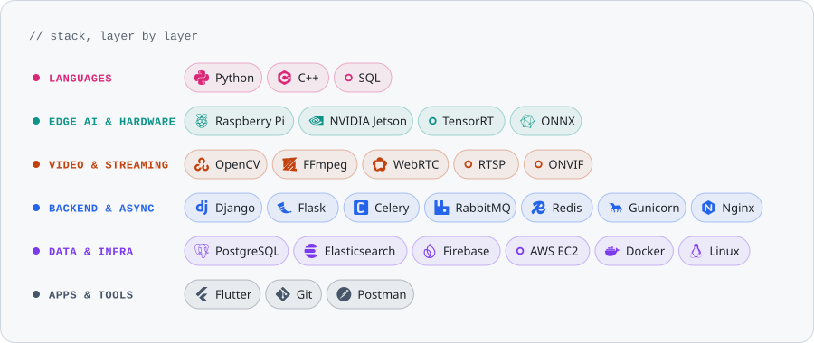

<picture>
  <source media="(prefers-color-scheme: dark)" srcset="assets/hero-dark.svg">
  
</picture>

  <a href="https://www.linkedin.com/in/ikaushalmartin/"><picture><source media="(prefers-color-scheme: dark)" srcset="assets/btn-linkedin-dark.svg"></picture></a>&nbsp;
  <a href="mailto:kaushalmartin@gmail.com"><picture><source media="(prefers-color-scheme: dark)" srcset="assets/btn-email-dark.svg"></picture></a>&nbsp;
  <a href="https://www.instagram.com/i.kaushalmartin/"><picture><source media="(prefers-color-scheme: dark)" srcset="assets/btn-instagram-dark.svg"></picture></a>
  
I engineer systems end to end: AI that runs on single-board computers with minimal compute, the real-time pipelines that move their data, and the backends that run it all at scale. Today I do this at <b>Intozi</b>, where the video-analytics and Edge AI systems I build run 24/7 in the field.

<picture>
  <source media="(prefers-color-scheme: dark)" srcset="assets/flow-dark.svg">
  
</picture>

<picture>
  <source media="(prefers-color-scheme: dark)" srcset="assets/ladder-dark.svg">
  
</picture>

<picture>
  <source media="(prefers-color-scheme: dark)" srcset="assets/stack-dark.svg">
  
</picture>

  <picture>
    <source media="(prefers-color-scheme: dark)" srcset="https://streak-stats.demolab.com?user=ikaushalmartin&background=161B22&border=30363D&stroke=30363D&ring=60A5FA&fire=F472B6&currStreakNum=E6EDF3&sideNums=E6EDF3&currStreakLabel=60A5FA&sideLabels=8B949E&dates=8B949E&border_radius=16">
    
  </picture>

  

